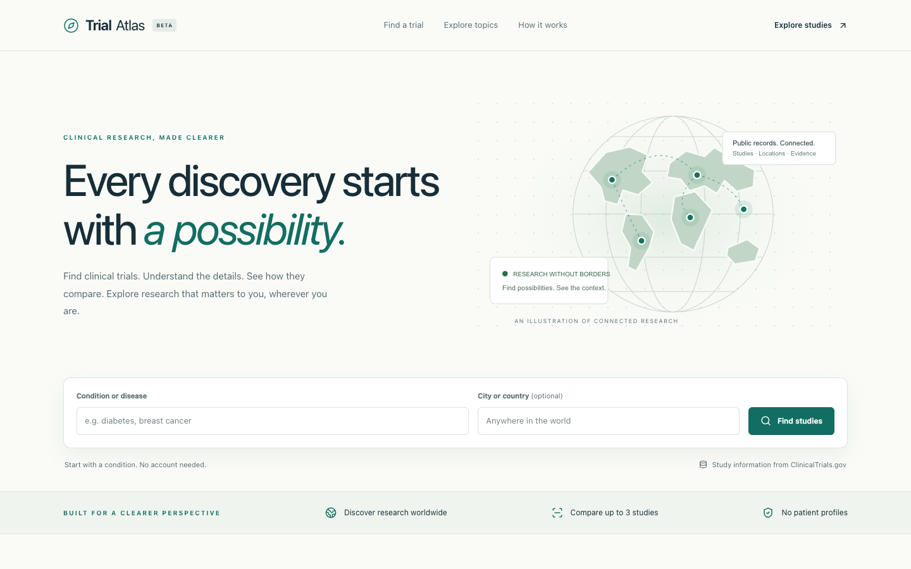

# TrialAtlas

A clinical trial finder for exploring public research, viewing study locations, and comparing studies side by side.



## Features

- Search by condition, location, intervention, sponsor, recruitment status, phase, age group, and study type.
- Explore interactive maps with Arabic and right-to-left label support.
- Read study details, eligibility criteria, and linked PubMed citations.
- Compare up to three studies, share a comparison link, and export PDF or CSV summaries.
- Browse search-engine-friendly condition and medical-imaging topic pages.

No accounts or patient profiles. Study contact details are omitted from dedicated contact fields and exports; participation inquiries link to the official study record.

## Run locally

Requires Node.js 22 or newer.

```bash
npm ci
cp .env.example .env.local
npm run dev
```

Open [localhost:3000](http://localhost:3000).

Set `NEXT_PUBLIC_SITE_URL` to your public URL before deploying. Set `NCBI_EMAIL` to your maintainer email; `NCBI_API_KEY` is optional and must remain server-only. Never commit `.env.local`.

## Built with

Next.js App Router, TypeScript, Tailwind CSS, MapLibre, OpenFreeMap, and React PDF.

Code is organized into `src/app` (routes), `src/features` (domain UI), `src/components` (shared UI), `src/lib` (API adapters and validation), and `src/config` (editorial content).

## Data sources and terms

Study data come from [ClinicalTrials.gov](https://clinicaltrials.gov), a U.S. Government database maintained by NLM/NIH. Citation metadata come from [PubMed](https://pubmed.ncbi.nlm.nih.gov/). TrialAtlas is independent, claims no ownership of these databases, and is not endorsed by NLM, NIH, or the U.S. Government.

The operator acknowledges and accepts the applicable [ClinicalTrials.gov terms](https://clinicaltrials.gov/about-site/terms-conditions), [NLM data-use conditions](https://www.nlm.nih.gov/databases/download.html), and [NCBI policies](https://www.ncbi.nlm.nih.gov/home/about/policies/). Third-party copyright restrictions still apply. Extracted study email addresses must not be used for marketing.

The app uses APIs rather than a bundled study dataset. Study data revalidate after six hours and PubMed metadata after 24 hours when requested. Failed refreshes may leave older cached data visible. Exports are dated snapshots. API caches and build output are excluded from Git; test fixtures are synthetic.

Selected fields are reformatted, summaries are visually shortened on cards, labels are made readable, and structured study contact fields are omitted. The app's **Sources & methodology** and **Data sources & terms** pages explain these changes. Always check the official record for current details.

For research discovery only—not medical advice, an eligibility assessment, or an enrollment service.

## Checks

```bash
npm run lint
npm run typecheck
npm test
npm run build
npm run test:browser
```

Browser tests use Chrome and synthetic API responses on port 3100. See [QA notes](docs/QA-REVIEW.md) for coverage and limitations.

## Deploy

Import this repository into Vercel with the **Next.js** preset, configure the environment variables above, and deploy. Use the default build/output settings. No application database is required.

PubMed request throttling is per server process; coordinate a shared quota/cache before scaling to substantial traffic.
